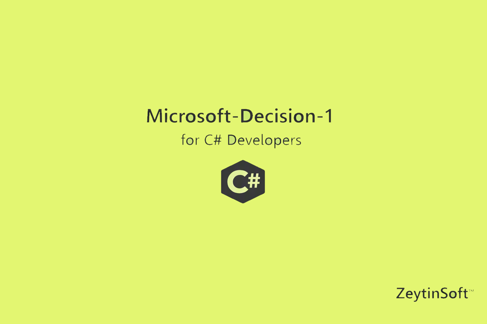

# Microsoft-Decision-1-Csharp-Demo




A small .NET 10 console app that sends a support ticket to **Microsoft-Decision-1**, a decision model in Microsoft Foundry. It prints:

- the team that should handle the ticket (`billing`, `engineering`, or `support`) and its probability
- a severity score and level
- the probability that the customer has contacted support before

If the team probability is below 70%, the app suggests sending the ticket to a person.

## Prerequisites

- [.NET 10 SDK](https://dotnet.microsoft.com/download)
- A Microsoft Foundry resource with a Microsoft-Decision-1 deployment
- Azure credentials that `DefaultAzureCredential` can use (for example, `az login`) and permission to call the resource

## Configuration

The app reads these settings from user secrets or environment variables:

| Name | Required | Description |
| --- | --- | --- |
| `AZURE_AI_ENDPOINT` | Yes | Base URL of the Foundry resource, with no path, for example `https://<resource>.services.ai.azure.com` |
| `AZURE_AI_DEPLOYMENT` | No | Deployment name. Defaults to `microsoft-decision-1` |

Set them with user secrets from the project folder:

```bash
dotnet user-secrets set "AZURE_AI_ENDPOINT" "https://<resource>.services.ai.azure.com"
dotnet user-secrets set "AZURE_AI_DEPLOYMENT" "<your-deployment-name>"
```

## Run

```bash
dotnet run
```

Example output:

```
Team:     engineering  (p=92%)
Severity: 0.87  level=Critical
Repeat:   99%
```

## How it works

`Program.cs` gets a token for `https://cognitiveservices.azure.com/.default`, then POSTs to `{AZURE_AI_ENDPOINT}/providers/microsoft/v1/systemone`. The body contains the ticket text (`state`) and three questions: `team` (choice), `severity` (score), and `repeat_contact` (noul). The response's `answers` object is parsed into the records at the bottom of the file.

## Troubleshooting

### `Decision API returned 404: Resource not found`

The endpoint URL is wrong. The app appends `/providers/microsoft/v1/systemone` to `AZURE_AI_ENDPOINT`, so the value must be the base URL only.

- **Wrong:** `https://<resource>.services.ai.azure.com/models` (any path such as `/models`, `/api/projects/...`, or `/openai` is appended to the route and produces a bad URL)
- **Right:** `https://<resource>.services.ai.azure.com`

A trailing slash is fine because the app trims it. If the base URL is correct and you still get 404, check that `AZURE_AI_DEPLOYMENT` matches the name of your Microsoft-Decision-1 deployment exactly.

### Your endpoint change has no effect

Environment variables override user secrets. If `AZURE_AI_ENDPOINT` is set in your shell, update or unset it there (`echo $AZURE_AI_ENDPOINT` shows the current value), or the old value is still used.

To check which value the app sees, list the secrets:

```bash
dotnet user-secrets list
```

### `400: no_content_length_header`

The request was sent without a `Content-Length` header. This is fixed in the current `Program.cs`, which sends the body with `StringContent`. If you see this error, make sure your copy includes that change and does not use `JsonContent`.

### `401` or `403` responses, or credential errors

- Run `az login` and check that the signed-in account has access to the Foundry resource.
- `DefaultAzureCredential` uses the first credential that works, so a different cached login can be used. Sign out and sign in again with the right account if needed.

### `KeyNotFoundException` when reading the response

The response shape differs from what the parser expects. The error message includes the raw answer JSON. Compare that with `ReadChoice`, `ReadScore`, and `ReadNoul` in `Program.cs`.

## License

This project is licensed under the MIT License. See [LICENSE](LICENSE).
